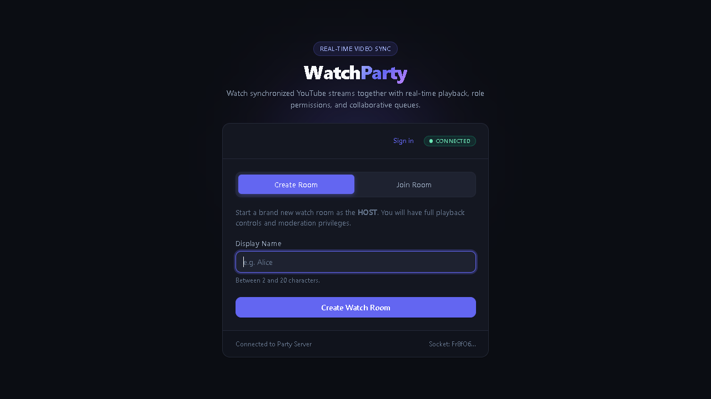
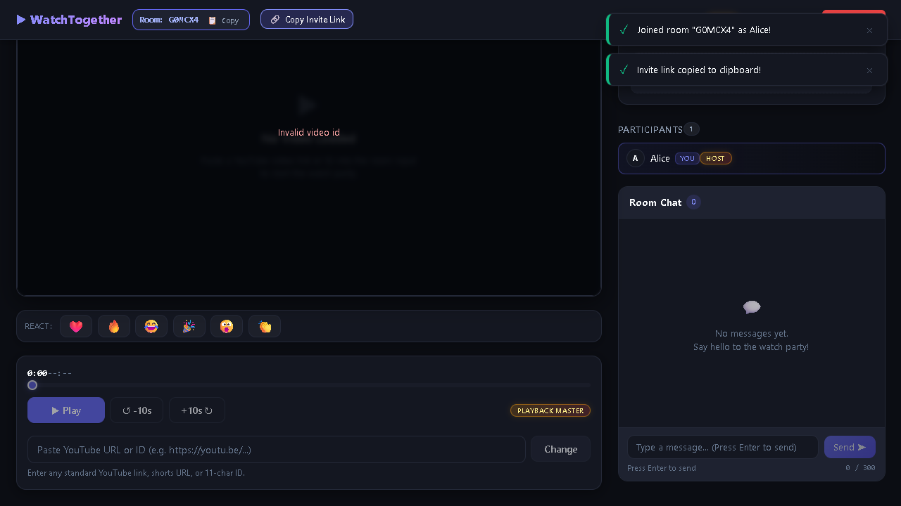
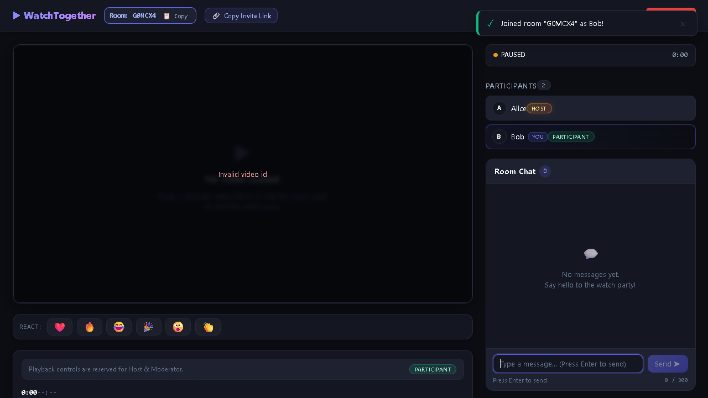
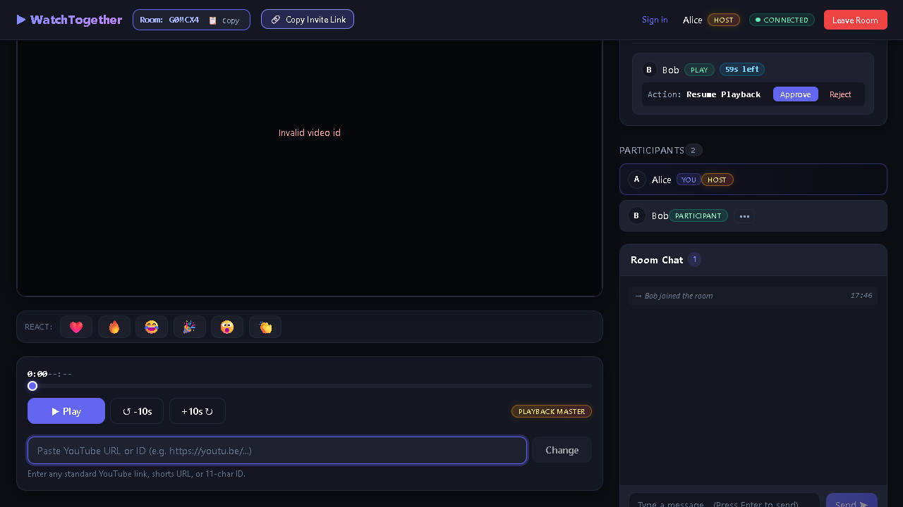
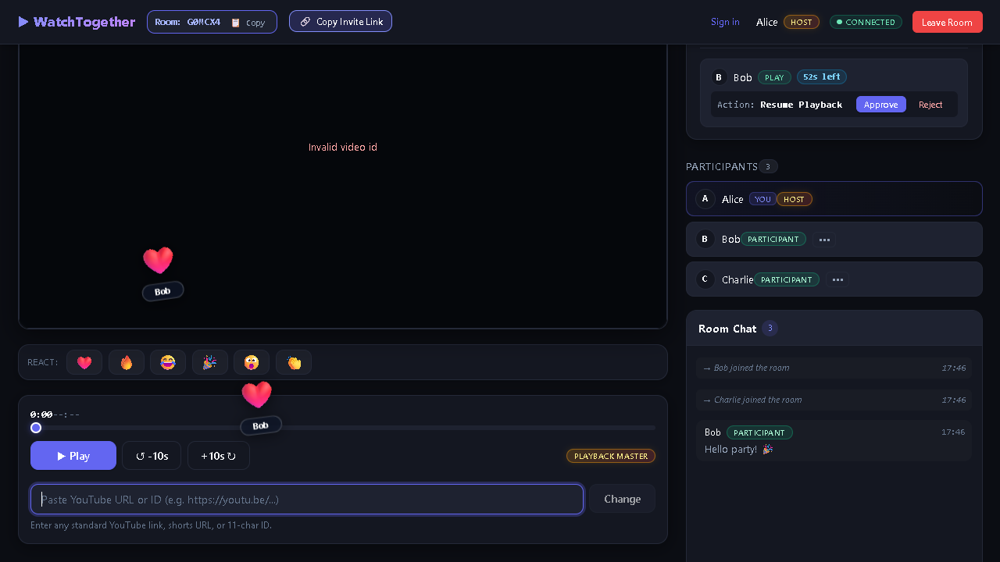
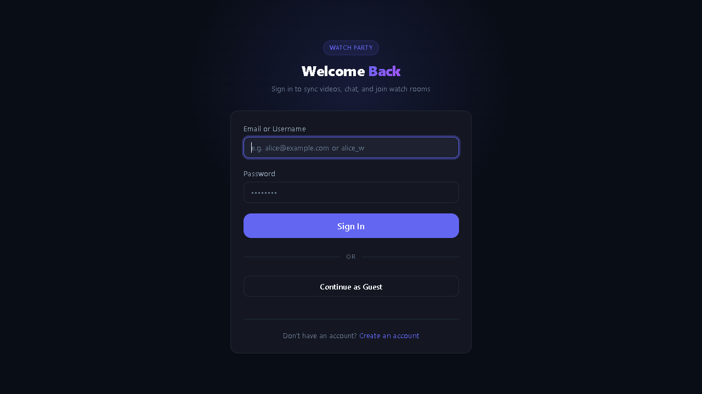
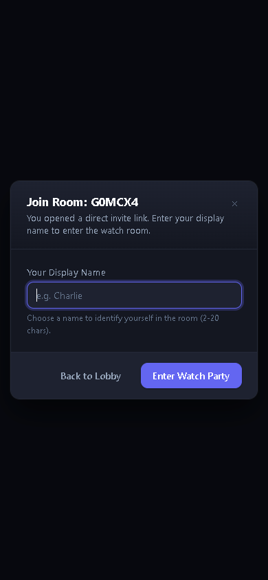
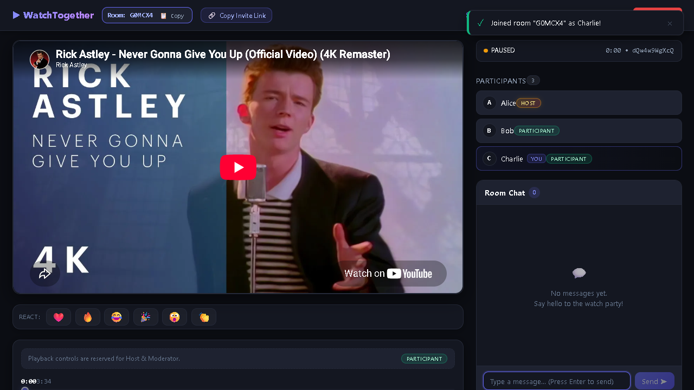

# 🎬 YouTube Watch Party

A real-time synchronized YouTube watch party application built with modern vanilla JavaScript (ES modules). It features server-authoritative playback synchronization, role-based access control (RBAC), moderation approval queues, live chat with rate limiting, floating emoji reactions, JWT user authentication with guest mode fallback, and persistent state restoration via MongoDB.

---

## 🚀 Live Demo & Deployment

- **Frontend Client (Vercel)**: `https://watch-party-wine.vercel.app`
- **Backend API & WebSockets (Render)**: `https://watch-party-1-d3jw.onrender.com`

---

## 📸 Screenshots

| View | Screenshot | Caption |
| :--- | :---: | :--- |
| **01. Lobby / Landing** |  | Landing page with Create Room and Join Room forms and real-time server connectivity status. |
| **02. Host Room View** |  | Host view with full synchronized video controls, seek bar, and active participants list. |
| **03. Participant Room View** |  | Participant view with disabled playback controls and collaborative Action Request panel. |
| **04. Moderation Approval Panel** |  | Host/moderator approval queue displaying incoming participant playback requests. |
| **05. Role Management Menu** |  | Host-only participant administration menu for role assignment (Moderator/Viewer) and eviction. |
| **06. Live Chat & Floating Reactions** |  | Real-time chat messages with sanitization and animated emoji reactions floating over the player. |
| **07. User Authentication** |  | User sign-in view with form validation, JWT session handling, and guest mode fallback. |
| **08. Mobile Responsive Layout** |  | Adaptive room interface optimized for mobile viewports (390px width). |
| **09. Participant Eviction** |  | Eviction notification and automatic channel disconnection screen for removed users. |

---

## 🏗️ Architecture & Features

- **Server-Authoritative Sync**: Video time is calculated on the fly via mathematical extrapolation ($t_{\text{now}} = t_{\text{base}} + \Delta t$), avoiding packet spam.
- **Granular RBAC**:
  - `HOST`: Master playback control, video changes, role promotions/demotions, participant removal, and request approvals.
  - `MODERATOR`: Playback control, video changes, and request approvals.
  - `PARTICIPANT`: Synchronized playback viewer with proposal queue (`request_action`), chat, and emoji reactions.
  - `VIEWER`: Read-only attendee with chat and emoji reactions.
- **Auto-Promotion**: If the host disconnects, the server automatically promotes the earliest-joined moderator (or participant).
- **Multi-Origin CORS & Cloud Deployment**: Configured for Render backend (`0.0.0.0` binding, graceful `SIGTERM` shutdown) and Vercel frontend (`*.vercel.app` preview branch support).
- **Cold-Start Warm-up**: Frontend probes `/health` on load with a friendly animated screen to wake sleeping cloud containers.

---

## 🧪 Testing

### Automated Unit Tests
The backend test suite uses **Vitest** with 21 test files covering domain models, socket handlers, role permissions, MongoDB repository, and authentication:

```bash
# Run server test suite
npm --prefix server test
```

### Socket Smoke Test
Runs end-to-end socket events over actual TCP sockets against a running server:

```bash
# Run local socket smoke test
npm --prefix server run smoke:local
```

### Manual Test Checklist
1. **Lobby Validation**: Submit empty name/code; verify inline validation alerts.
2. **Direct Invite Links**: Open `/room/:roomId` directly; verify auto-join for logged-in users and prompt modal for guests.
3. **Playback Sync**: Verify Participant follows Host play, pause, seek, and video changes within 2 seconds.
4. **Action Requests**: Propose a play/seek as Participant; verify it appears in Host's Approval Panel and applies on approval.
5. **Role Promotion**: Host promotes Participant to Moderator; verify controls enable immediately.
6. **Eviction**: Host kicks participant; verify target socket is disconnected and sees removal screen.
7. **Chat & Reactions**: Verify 300-char max, HTML escaping, 5 msg/10s rate limiting, and floating reaction animations.

### Test Run Results (November 18, 2026)
- **Unit Tests**: **214 / 214 Passed** (21 test files, 0 failures).
- **Automated Smoke Test**: **6 / 6 Steps Passed**.
- **Browser E2E Test Suite**: **19 / 19 Items Passed**.

---

## ⚠️ Known Limitations

1. **Free-Tier Container Sleep**: When hosted on Render's free tier, the backend sleeps after 15 minutes of inactivity. Initial page loads may take 30–60 seconds while the container spins up (handled by the client's `ColdStartScreen`).
2. **Browser Autoplay Restrictions**: Mobile browsers and strict desktop policies require a user click/gesture before playing unmuted audio. Initial video loading begins muted if autoplay is restricted.
3. **Session Storage (XSS vs CSRF)**: JWT tokens are stored in browser `localStorage` to allow direct transmission in Socket.IO handshake auth dictionaries and avoid third-party cross-origin cookie restrictions between Vercel and Render.
